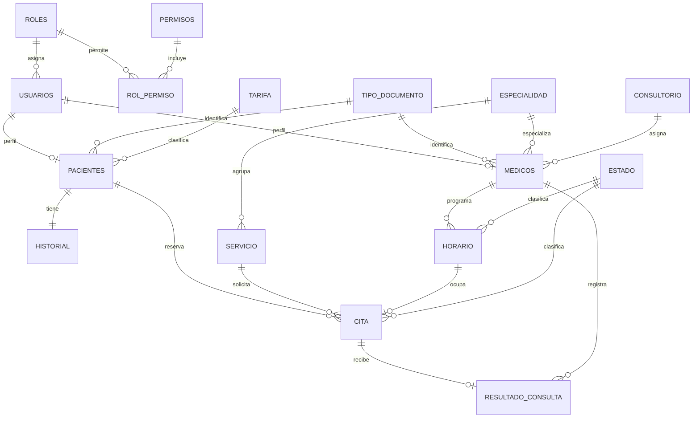

# 🏥 EPS Villavicencio
### Proyecto académico de citas médicas

Aplicación local desarrollada con PHP, PostgreSQL, HTML, CSS y JavaScript nativo. El servidor se ejecuta en `127.0.0.1` y solo se abre en este computador.

> Los nombres y datos iniciales son ficticios. No ingreses información clínica real.

## Funciones

- El paciente crea una cuenta, consulta su afiliación e historia, ve sus citas y reserva un horario cuando está activo.
- El médico consulta sus citas pendientes. Al guardar el resultado, la cita pasa a Atendida y queda disponible en el historial del médico.
- El administrador puede crear afiliados, corregir sus datos, revisar afiliaciones, crear cuentas médicas y configurar horarios.
- Las categorías se asignan por ingreso: A hasta $1.000.000, B hasta $2.500.000 y C por encima de ese valor. El copago aumenta por categoría y tiene un tope de $10.000 por cita.
- El formulario no muestra el costo base junto al servicio. Después de elegirlo, indica el copago estimado y filtra los horarios a la especialidad correspondiente.
- El catálogo inicial contiene 16 servicios y 12 especialidades. Para especialidades sin agenda inicial, administración debe crear el médico y su horario.
- La base incluye siete consultorios y siete médicos de demostración en medicina general, pediatría, odontología, cardiología, dermatología y ginecología.
- Los formularios de registro muestran errores junto al campo mientras se escriben datos inválidos. El encabezado incluye una ventana de ayuda.
- El pago se realiza por fuera del portal. Administración cambia el estado a Activo después de verificarlo.

El proyecto maneja únicamente las categorías A, B y C; no intenta adivinar un régimen especial por el documento o el nombre del empleador. Si se necesitara una exención para funcionarios, tendría que asignarse explícitamente como una categoría o beneficio aparte.

## Requisitos

- Linux, PHP 8.2 o superior con `pdo` y `pdo_pgsql`.
- PostgreSQL 14 o superior.

## Instalación en una base nueva

Si ya tienes una base anterior con tablas del mismo proyecto, **no ejecutes el nuevo SQL encima**. Esta versión cambia las tarifas y relaciona los servicios con especialidades. Conserva la base anterior y crea una base vacía nueva, por ejemplo `eps_villavicencio_local`.

### 1. Crear la base de datos

```bash
sudo -u postgres createdb eps_villavicencio_local
```

### 2. Ejecutar el único archivo SQL

```bash
sudo -u postgres psql -d eps_villavicencio_local -v ON_ERROR_STOP=1 -f proyecto.sql
```

El script ordena y crea las tablas, roles y permisos funcionales, restricciones, funciones, disparadores y datos de ejemplo. La primera vez pedirá una contraseña para el usuario PostgreSQL `eps_app`; guárdala para el siguiente paso. El script se ejecuta una vez por cada base vacía.


### 3. Configurar la conexión en la misma terminal

```bash
cd ~/Descargas/Proyectofinal-bases
export DB_HOST=127.0.0.1
export DB_PORT=5432
export DB_NAME=eps_villavicencio_local
export DB_USER=eps_app
read -s -p "Contraseña PostgreSQL de eps_app: " DB_PASSWORD
export DB_PASSWORD
echo
```

La contraseña se escribe sin mostrarse en pantalla. Las variables duran mientras esa terminal siga abierta.

### 4. Iniciar la página solo en el computador local

En esa misma terminal ejecuta:

```bash
php -S 127.0.0.1:8000
```

Abre <http://127.0.0.1:8000>. Para detener el servidor, presiona `Ctrl+C`.

## Cuentas iniciales

El SQL crea 23 cuentas de demostración: una administrativa, siete médicas y quince de pacientes. Todas usan la contraseña de acceso **`DemoEPS2026`**.

- Administración: `admin.eps`
- Médicos: `diana.rojas`, `carlos.mejia`, `lucia.torres`, `andres.mora`, `carolina.gil`, `felipe.ruiz`, `natalia.santos`
- Pacientes: `ana.martinez`, `luis.gomez`, `laura.ramirez`, `miguel.perez`, `sofia.lopez`, `juan.hernandez`, `valentina.diaz`, `mateo.castillo`, `isabella.vargas`, `santiago.ruiz`, `camila.moreno`, `daniel.ortiz`, `gabriela.silva`, `samuel.reyes`, `mariana.castro`

Son cuentas de muestra: cambia o elimina estos datos antes de usar la aplicación fuera de una demostración académica. Las cuentas nuevas de paciente comienzan con afiliación Pendiente.

## Roles y permisos explicados

La tabla `roles` contiene Paciente, Médico y Administrador. La tabla `permisos` enumera acciones; `rol_permiso` indica qué acciones tiene cada perfil. PHP consulta esa relación antes de procesar las acciones del usuario. Pacientes y médicos tienen pantallas y acciones limitadas; administración tiene las herramientas de gestión.

Para la conexión local, PostgreSQL usa un solo usuario de aplicación, `eps_app`, con permisos `SELECT`, `INSERT`, `UPDATE` y `DELETE` sobre las tablas del proyecto. La separación por paciente, médico y administrador se aplica en la aplicación PHP mediante las tablas de roles y permisos.

## Abrir y revisar la base de datos

Puedes entrar a PostgreSQL desde otra terminal:

```bash
sudo -u postgres psql -d eps_villavicencio_local
```

Comandos útiles dentro de `psql`:

```sql
\dt
\d pacientes
SELECT username, id_rol FROM usuarios;
SELECT estado_afiliacion, COUNT(*) FROM pacientes GROUP BY estado_afiliacion;
\q
```

`\dt` lista las tablas; `\d pacientes` describe columnas y restricciones; `SELECT` consulta los datos; `\q` cierra `psql`.

## Modelo entidad-relación

GitHub muestra el siguiente diagrama Mermaid directamente en este README:



También se encuentra como fuente editable en [modelo_entidad_relacion.mmd](modelo_entidad_relacion.mmd).

## Archivos principales

| Archivo | Contenido |
|---|---|
| `proyecto.sql` | Único script de base de datos: estructura, permisos, disparadores y muestra de 20 usuarios. |
| `index.php` | Formularios, validaciones y paneles por rol. |
| `Database.php` y `config.php` | Conexión local de PHP con PostgreSQL. |
| `assets/app.css` | Diseño institucional con bordes sutiles y tarjetas sencillas. |
| `assets/ilustracion-familia.png` | Ilustración amplia del inicio de sesión. |
| `modelo_entidad_relacion.mmd` | Diagrama entidad-relación editable. |
| `Informe_Proyecto.docx` | Informe, objetivos, justificación y diccionario de datos. |

## Validaciones destacadas

- Los nombres y apellidos no admiten números.
- CC, TI y RC: solo dígitos, hasta 10 caracteres.
- CE y PA: letras y números, hasta 20 caracteres.
- Ingresos, costos y capacidad no pueden ser negativos.
- Una cita ocupa un único horario; un disparador calcula el valor y otro actualiza el estado del horario.
