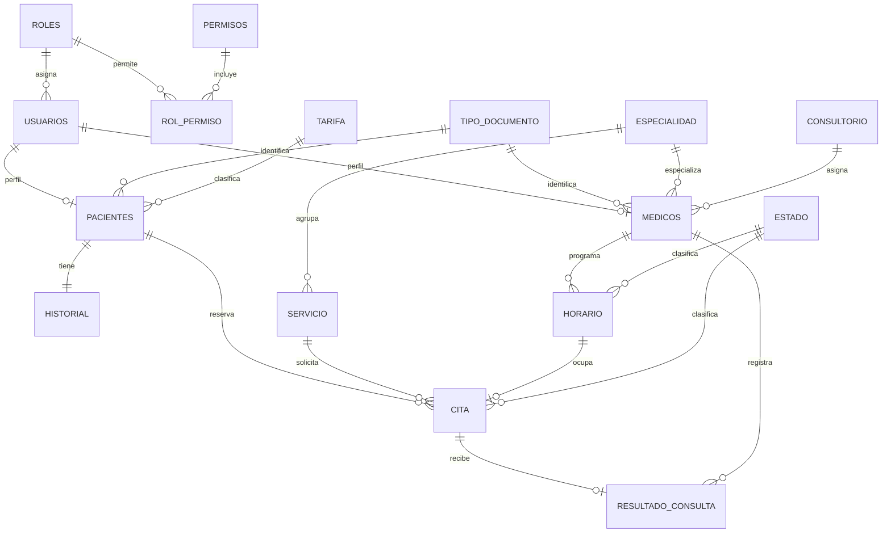

# EPS Villavicencio

## Sistema local de citas médicas

Proyecto académico desarrollado con PHP, PostgreSQL, HTML, CSS y JavaScript nativo. Permite registrar afiliados, administrar profesionales y horarios, reservar citas y consultar sus resultados.

> Los datos incluidos son ficticios y se usan para demostración. No ingreses información médica real.

## Requisitos

- Linux
- PHP 8.2 o superior, con `PDO` y `pdo_pgsql`
- PostgreSQL 14 o superior

En Ubuntu, instala los componentes necesarios con:

```bash
sudo apt update
sudo apt install php php-pgsql postgresql
```

## Instalación y ejecución local

Ejecuta estos pasos desde una terminal.

### 1. Crear una base de datos vacía

```bash
sudo -u postgres createdb eps_villavicencio_local
```

Si esa base ya existe, elige otro nombre. El archivo `proyecto.sql` debe ejecutarse una sola vez en una base vacía; no lo importes encima de una base que ya tenga las tablas del proyecto.

### 2. Importar el proyecto

```bash
cd ~/Descargas/Proyectofinal-bases
psql -h 127.0.0.1 -U postgres -d eps_villavicencio_local -v ON_ERROR_STOP=1 -f proyecto.sql
```

`psql` pedirá la contraseña del usuario PostgreSQL `postgres`. Durante la importación, el script también pedirá crear una contraseña para `eps_app`. Anótala: se usará en el siguiente paso.

### 3. Configurar la conexión

En la misma terminal:

```bash
export DB_HOST=127.0.0.1
export DB_PORT=5432
export DB_NAME=eps_villavicencio_local
export DB_USER=eps_app
read -s -p "Contraseña PostgreSQL de eps_app: " DB_PASSWORD
export DB_PASSWORD
echo
```

La contraseña no se muestra mientras la escribes. No la guardes en el repositorio ni la publiques en GitHub.

### 4. Iniciar el servidor local

Desde la carpeta del proyecto:

```bash
php -S 127.0.0.1:8000
```

Abre <http://127.0.0.1:8000> en el navegador. Para detener el servidor, vuelve a la terminal y presiona `Ctrl+C`. El servidor queda limitado a este computador.

Las variables de conexión duran mientras la terminal permanezca abierta. Si inicias una terminal nueva, vuelve a configurarlas antes de iniciar PHP.

## Cuentas de demostración

El SQL crea 23 cuentas ficticias: una administrativa, siete médicas y quince de pacientes. Todas usan la contraseña temporal `DemoEPS2026`.

| Perfil | Usuario de ejemplo |
|---|---|
| Administrador | `admin.eps` |
| Médico | `diana.rojas` |
| Afiliado | `ana.martinez` |

Estas cuentas sirven para conocer los distintos paneles. No reutilices la contraseña de demostración para datos personales.

## Perfiles y funciones

### Afiliado

- Crea una solicitud de afiliación y consulta su estado.
- Puede reservar citas cuando su afiliación está Activa.
- Consulta sus próximas citas, el copago y los resultados registrados.
- Solo ve su propia historia y sus propias citas.

### Médico

- Consulta las citas pendientes asignadas a su agenda y la información clínica necesaria para atenderlas.
- Registra el resultado de la atención.
- Al guardar el resultado, la cita pasa a Atendida y se conserva en su historial.
- No administra afiliados ni horarios.

### Administrador

- Revisa solicitudes y cambia el estado de afiliación después de verificar el pago externo.
- Registra afiliados y actualiza sus datos.
- Crea cuentas médicas y asigna especialidades y consultorios.
- Configura los horarios de atención.

La aplicación utiliza roles y permisos para mostrar y limitar las acciones disponibles en cada perfil. PostgreSQL se conecta mediante el usuario local `eps_app`.

## Reglas del sistema

- Las categorías A, B y C se asignan según el ingreso declarado: A hasta $1.000.000, B hasta $2.500.000 y C por encima de ese valor.
- El copago depende de la categoría y del servicio, y no supera $10.000 por cita. El costo base no aparece al lado del servicio; el portal muestra el copago al seleccionarlo.
- Los horarios disponibles se filtran según la especialidad del servicio seleccionado.
- La afiliación queda Pendiente hasta que el administrador confirme el pago externo.
- Los nombres y apellidos no admiten números.
- CC, TI y RC aceptan solo números, con un máximo de 10 caracteres. CE y PA aceptan letras y números, con un máximo de 20.
- Ingresos, costos y capacidad no pueden ser negativos.
- Cada horario se reserva para una sola cita. Los disparadores calculan el copago y actualizan el estado del horario.

## Modelo entidad-relación

GitHub representa este diagrama Mermaid directamente en la página:



El diagrama también está disponible como fuente editable en [modelo_entidad_relacion.mmd](modelo_entidad_relacion.mmd).

## Archivos principales

| Archivo | Función |
|---|---|
| `proyecto.sql` | Crea la base de datos del proyecto, sus tablas, relaciones, restricciones, funciones, disparadores y datos ficticios iniciales. |
| `index.php` | Maneja el inicio de sesión, los formularios y los paneles de afiliado, médico y administrador. |
| `Database.php` y `config.php` | Configuran la conexión PHP con PostgreSQL mediante variables de entorno. |
| `assets/app.css` | Estilos de la aplicación. |
| `assets/favicon.svg` | Ícono de la pestaña del navegador. |
| `assets/ilustracion-familia.png` | Ilustración de la página de ingreso. |
| `modelo_entidad_relacion.mmd` | Diagrama entidad-relación editable. |
| `Informe_Proyecto.docx` | Informe académico del proyecto. |

## Revisar la base de datos

Desde otra terminal, abre la base:

```bash
sudo -u postgres psql -d eps_villavicencio_local
```

Comandos útiles dentro de `psql`:

```sql
\dt
\d pacientes
SELECT username FROM usuarios;
SELECT estado_afiliacion, COUNT(*) FROM pacientes GROUP BY estado_afiliacion;
\q
```
