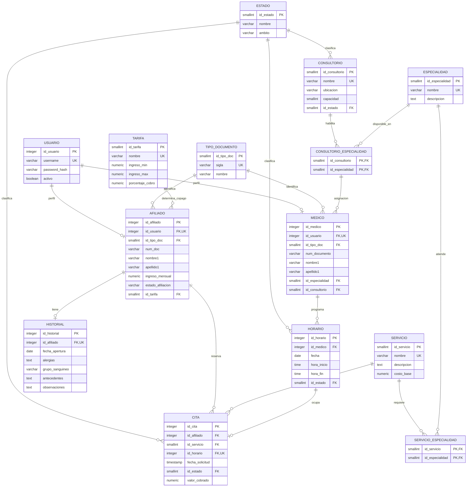

# 🏥 EPS Villavicencio

## Sistema local de reserva de citas médicas

Proyecto académico desarrollado con PHP, PostgreSQL, HTML, CSS y JavaScript nativo. Permite registrar afiliados, organizar profesionales y consultorios, reservar citas y consultar resultados de atención.

> La información incluida es ficticia y sirve para demostración. No registres pacientes ni datos clínicos reales.

## Funciones principales

- Registro de solicitudes de afiliación y revisión administrativa.
- Consulta y actualización de datos de afiliados.
- Registro de médicos, especialidades y consultorios.
- Configuración de horarios de atención.
- Reserva, consulta y cancelación de citas.
- Registro del resultado de atención por parte del médico.
- Copago calculado automáticamente según el servicio y la categoría del afiliado.
- Filtro de horarios disponibles según el servicio y la especialidad que lo atiende.

## Requisitos

- Linux
- PHP 8.2 o superior con PDO y `pdo_pgsql`
- PostgreSQL 14 o superior

En Ubuntu, instala los componentes necesarios:

```bash
sudo apt update
sudo apt install php php-pgsql postgresql
```

## Instalación local paso a paso

Ejecuta los siguientes comandos en una terminal.

### 1. Borrar la base anterior y crear una nueva

Si quieres empezar desde cero, primero detén el servidor PHP con `Ctrl+C`. El siguiente comando elimina permanentemente todos los datos de `eps_villavicencio`:

```bash
sudo -u postgres dropdb --if-exists eps_villavicencio
sudo -u postgres createdb eps_villavicencio
```

No ejecutes `dropdb` si necesitas conservar información. `proyecto.sql` crea las tablas, catálogos y datos de demostración; impórtalo una sola vez en la base vacía.

### 2. Importar el archivo SQL

Desde la carpeta del proyecto:

```bash
cd ~/Descargas/Proyectofinal-bases
psql -h 127.0.0.1 -U postgres -d eps_villavicencio -v ON_ERROR_STOP=1 -f proyecto.sql
```

`psql` solicitará la contraseña PostgreSQL de `postgres`. El script crea el usuario de conexión `eps_app` con la clave local de demostración `2345`.

### 3. Iniciar la aplicación

```bash
php -S 127.0.0.1:8000
```

Abre <http://127.0.0.1:8000>. El servidor escucha solo en `127.0.0.1`, por lo que la aplicación se usa localmente. Detén el servidor con `Ctrl+C`.

`config.php` usa por defecto la base `eps_villavicencio` y el usuario local `eps_app`. Si necesitas otros datos de conexión, puedes definir las variables `DB_HOST`, `DB_PORT`, `DB_NAME`, `DB_USER` y `DB_PASSWORD` antes de iniciar PHP.

## Cuentas de demostración

Todas las cuentas de ejemplo usan la clave `2345`.

| Perfil | Tipo y número de documento | Clave |
|---|---|---|
| Administrador | CC `99999999` | `2345` |
| Médicos de demostración | CC `90000001` a `90000007` | `2345` |
| Afiliados de demostración | CC `10000001` a `10000007` | `2345` |

El SQL inicializa 15 cuentas en total: un administrador, siete médicos y siete afiliados. Las cuentas usan documentos CC consecutivos: médicos `90000001` a `90000007` y afiliados `10000001` a `10000007`. Todas usan la clave `2345`. Los afiliados `10000001`, `10000003` y `10000006` están activos para probar las categorías A, B y C; los demás quedan pendientes para que se pueda mostrar la revisión administrativa.

## Perfiles y funciones

### Afiliado

- Solicita su afiliación desde el formulario de registro.
- Consulta y actualiza sus datos personales.
- Reserva citas cuando su afiliación está activa.
- Consulta sus citas, copagos e historia clínica.
- Cancela sus citas programadas.

### Médico

- Consulta las citas asignadas a su agenda.
- Registra el resultado de la cita atendida.
- No crea afiliados ni modifica médicos, consultorios u horarios.

### Administrador

- Busca afiliados, revisa solicitudes y actualiza su estado después de verificar el pago externo.
- Registra y actualiza afiliados.
- Crea cuentas médicas y las asocia con especialidades y consultorios.
- Configura los horarios de atención.

## Roles y permisos en PostgreSQL

La aplicación identifica los perfiles mediante los registros asociados al usuario: afiliado, médico o administrador. En PostgreSQL, `proyecto.sql` crea los grupos `eps_lectura`, `eps_paciente`, `eps_medico` y `eps_administrador`, además del usuario `eps_app` que utiliza PHP para conectarse a la base.

Los permisos de la interfaz restringen las acciones disponibles para cada perfil. Los grupos PostgreSQL permiten asignar permisos distintos a usuarios que se conecten directamente a la base de datos.

## Reglas del sistema

- Categoría A: ingresos hasta $1.000.000.
- Categoría B: ingresos superiores a $1.000.000 y hasta $2.500.000.
- Categoría C: ingresos superiores a $2.500.000.
- El copago depende de la categoría y del servicio, con un máximo de $10.000 por cita.
- La afiliación permanece Pendiente hasta que el administrador confirme el pago externo.
- Los horarios se muestran según la especialidad correspondiente al servicio elegido.
- Un horario se reserva para una sola cita.
- Un afiliado no puede tener citas pendientes con horarios que se crucen; puede reservar varias el mismo día si una termina antes de que comience la siguiente.
- Los nombres no aceptan números; documentos, teléfonos, fechas e ingresos se validan en los formularios y en la base de datos.
- Los disparadores calculan el copago, actualizan el estado del horario y eliminan horarios disponibles que ya vencieron.

## Modelo entidad-relación

El siguiente diagrama está escrito en Mermaid, así que GitHub lo representa directamente en el README:



La fuente Mermaid completa, con los campos de las entidades, está en [modelo_entidad_relacion.mmd](modelo_entidad_relacion.mmd). El [INFORME.md](INFORME.md) incluye objetivos, justificación, modelo relacional y diccionario de datos.

## Archivos principales

| Archivo | Propósito |
|---|---|
| `proyecto.sql` | Crea las tablas, relaciones, restricciones, grupos PostgreSQL, disparadores y datos de demostración. |
| `index.php` | Contiene los formularios y los paneles de afiliado, médico y administrador. |
| `Database.php` y `config.php` | Gestionan la conexión PHP con PostgreSQL. |
| `assets/app.css` | Estilos de la interfaz. |
| `assets/favicon.svg` | Ícono de la pestaña del navegador. |
| `modelo_entidad_relacion.mmd` | Diagrama entidad-relación en formato Mermaid. |
| `INFORME.md` | Informe académico, modelo relacional y diccionario de datos. |

> Las claves incluidas son únicamente para datos locales de demostración. Cámbialas antes de usar el sistema con información real y no publiques datos personales.
